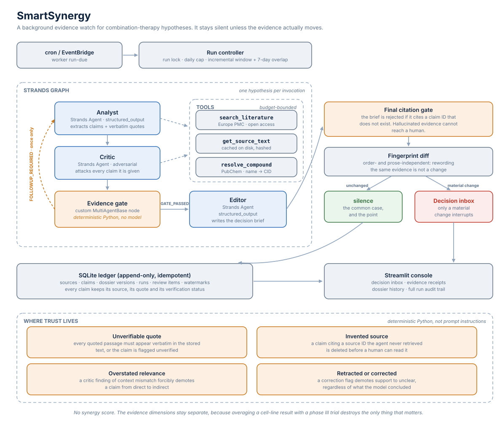
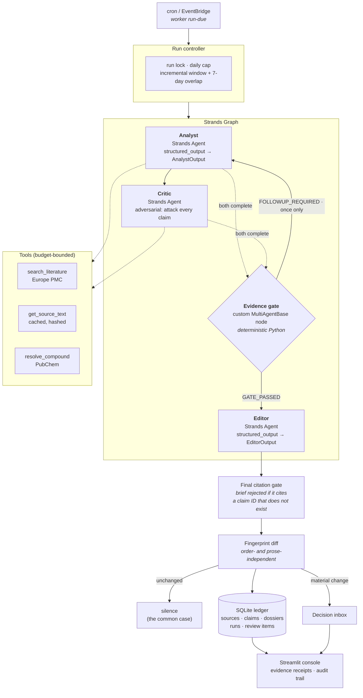

# SmartSynergy

### It reads the cancer literature every night, argues with itself about what it found, and wakes you only when the evidence actually changes.

An autonomous evidence watch for the people deciding which drug combinations are worth testing next — built on the [Strands Agents SDK](https://strandsagents.com).

> **Track:** Professional Agents · **Licence:** Apache-2.0 · **51 tests, all passing without AWS**

---

## The problem

A translational oncology researcher is tracking maybe a dozen combination-therapy hypotheses at once: *does pairing this KRAS G12C inhibitor with that second agent actually hold up?*

Answering it is not hard. Answering it **again, every week, forever** is what breaks people.

Roughly 4,000 new papers are indexed in Europe PMC every day. The relevant ones arrive unannounced. Miss a retraction and you cite a finding that no longer exists. Miss a negative trial and you spend six months and a lot of money re-learning it. So researchers do what humans do under that load: they check sporadically, they rely on whatever crosses their feed, and they quietly rely on assumptions that stopped being true months ago.

The failure is not a lack of intelligence. It is that **staying current is unbounded, repetitive work with no natural stopping point** — precisely the kind of work a background agent should own.

## Why this is not "a chatbot for PubMed"

Ask a language model about a drug combination and it will happily answer. That is the problem. It will:

- cite papers that do not exist,
- quote a result from **colorectal cancer** as if it applied to **lung cancer**,
- present a cell-line experiment in the same confident register as a phase III trial,
- and give you a different answer tomorrow for no reason at all.

SmartSynergy is built around the assumption that **its own model output cannot be trusted**. Every claim has to survive an adversarial critic and then a deterministic gate written in plain Python before a human ever sees it.

The output is not an answer. It is an **evidence profile with receipts** — and, most of the time, silence.

---

## What it actually does

```
$ python -m smartsynergy.worker run-due      # this is a cron job, not an app you open

kras-g12c-nsclc: completed | +3 sources | 1 need review | 47.2s
```

```
$ python -m smartsynergy.worker inbox

1 item(s) awaiting a decision

[ ] a7f3c91b04  kras-egfr  (context_mismatch, urgency 3)
     Support for this pair is weaker than it looked: the strongest evidence is colorectal, not lung
     why: Evidence previously read as applicable is from a different context (PMC10234567).
     v2->v3 | new sources: 38912004, PMC10234567
```

That is the entire product surface on a normal day. A researcher who gets nothing has learned something real: *nothing changed*.

### The four ways it will interrupt you

| Reason | Meaning |
| --- | --- |
| `new_direct_evidence` | New work in **your** disease and **your** variant supports the hypothesis |
| `new_counterevidence` | Directly applicable evidence now argues **against** it |
| `context_mismatch` | Evidence you were relying on turns out to be from another tumour type or variant |
| `source_corrected` | A source behind the assessment has been corrected or retracted |

Anything else — a new paper repeating a known result, a rephrasing, a review article citing work already in the ledger — is recorded and never surfaced.

---

## Architecture



<sub>Regenerate with `python scripts/make_architecture_diagram.py`. A PNG for slide decks lives at [`docs/architecture.png`](docs/architecture.png).</sub>

<details>
<summary>Same diagram as Mermaid source</summary>



</details>

Full walkthrough: [`docs/architecture.md`](docs/architecture.md).

### How Strands is used

| Strands feature | Where, and why |
| --- | --- |
| `GraphBuilder` | Four-node graph with **conditional edges**, not a linear chain |
| Custom `MultiAgentBase` node | The evidence gate is a real graph node that runs Python, not a model — so trust decisions are testable |
| Conditional edges | The gate emits `GATE_PASSED` / `FOLLOWUP_REQUIRED`; edges route on it, giving a **bounded** self-correction loop |
| AND-join condition | Python graphs fire on *any* incoming edge, so the gate uses an explicit condition to wait for **both** Analyst and Critic |
| `structured_output_model` | Every agent returns a validated Pydantic model. No regex over prose anywhere |
| `@tool` | Three tools that enforce their own budgets and refuse to exceed them |
| `set_max_node_executions`, `set_node_timeout`, `reset_on_revisit` | A background agent that can loop forever is a background agent that generates a surprise bill |
| Custom `Model` provider | `smartsynergy/testing.py` scripts a model so the **entire graph runs in CI** with no network and no AWS account |

---

## Where trust is actually enforced

This is the part that matters, and **none of it is a prompt instruction.** Prompts are requests. These are rules, in `smartsynergy/gates.py`, with tests.

| Failure mode | The defence | Test |
| --- | --- | --- |
| Fabricated citation | A claim whose `source_id` was never returned by a tool **is deleted**. It cannot reach a human. | `test_rejects_claims_about_sources_that_were_never_retrieved` |
| Quote drift / paraphrase presented as a quote | The supporting passage must be a whitespace-normalised substring of the stored source text, else `passage_verified = false` and the UI says so in red | `test_verbatim_quote_must_appear_in_the_retrieved_text` |
| Wrong-context evidence | A critic finding of `context_mismatch` **forcibly demotes** `direct` → `indirect_other_tumor`. The model does not get a vote. | `test_critic_context_mismatch_demotes_direct_evidence` |
| Retracted source still counted | A correction flag downgrades `supports` → `unclear` | `test_correction_flag_downgrades_support_to_unclear` |
| Infinite self-correction loop | The gate offers **exactly one** follow-up pass, then must decide | `test_followup_is_offered_once_and_only_once` |
| Brief citing evidence that does not exist | Final gate rejects the whole brief and says why | `test_final_gate_rejects_a_brief_citing_a_claim_that_does_not_exist` |
| Alert fatigue | Order- and prose-independent fingerprint; identical evidence produces identical fingerprints forever | `test_fingerprint_is_independent_of_order_and_prose` |
| Duplicate alerts | `UNIQUE(watch_id, hypothesis_id, fingerprint_after)` — the same change physically cannot alert twice | `test_the_same_change_never_alerts_twice` |
| Overlapping scheduled runs | Partial unique index on `runs(watch_id) WHERE status='running'` | `test_two_runs_of_the_same_watch_cannot_overlap` |
| A failed run looking like "all clear" | The watermark advances **only** on `coverage="complete"` | enforced in `controller.py`; surfaced in the run history UI |

### There is deliberately no "synergy score"

The obvious design is a number: *87% synergy confidence*. It would demo beautifully and it would be indefensible — you cannot average a cell-line result and a phase III trial into a single figure that means anything.

So the `EvidenceProfile` keeps the dimensions apart — direct support, indirect support, opposing, strongest design, independent sources, open gaps — and derives a **state**, not a score:

`supported_in_scope` · `indirect_support_only` · `conflicting_evidence` · `preclinical_only` · `insufficient_evidence` · `needs_review`

The distinction that matters most to a researcher is between **"no evidence"** and **"evidence of harm."** A score erases it. A state preserves it.

---

## Quickstart

```bash
git clone https://github.com/Lanceky/SmartSynergy && cd SmartSynergy
python3.13 -m venv .venv && .venv/bin/pip install -r requirements.lock.txt

cp .env.example .env          # set AWS_REGION and BEDROCK_MODEL_ID
.venv/bin/python scripts/smoke_bedrock.py     # confirm Bedrock access

.venv/bin/python -m smartsynergy.worker init-watch fixtures/panel.json
.venv/bin/python -m smartsynergy.worker run-watch kras-g12c-nsclc
.venv/bin/python -m smartsynergy.worker inbox
.venv/bin/python -m streamlit run app/streamlit_app.py
```

Run it on a schedule — which is the whole point:

```cron
0 6 * * *  cd /path/to/SmartSynergy && .venv/bin/python -m smartsynergy.worker run-due >> logs/watch.log 2>&1
```

### See it work right now, without AWS

```bash
.venv/bin/python scripts/seed_demo.py
```

This fetches **real** records from Europe PMC and plays three consecutive days through the real controller, the real evidence gate and the real storage layer — only the model's judgment is scripted. Day 1 builds a baseline and interrupts nobody, day 2 is silent, day 3 finds a contradiction and raises exactly one inbox item. Every quoted passage is verified verbatim against the live abstract.

### Requirements

- Python 3.13
- An AWS account with **Amazon Bedrock** model access. The default is `us.amazon.nova-pro-v1:0` because it needs no access request and supports the tool use that structured output depends on. Any tool-use-capable model works via `BEDROCK_MODEL_ID` — `us.anthropic.claude-sonnet-4-20250514-v1:0` gives better judgment if you have access to it.
- No API keys for the data sources. Europe PMC and PubChem are public.

### Commands

| Command | Purpose |
| --- | --- |
| `init-watch <panel.json>` | Define what to watch |
| `run-watch <id>` | Run one watch now |
| `run-due` | Run every enabled watch — the cron entry point |
| `inbox` | What needs a human decision |
| `decide <item> acknowledged\|dismissed\|acted_on` | Record the decision |
| `list-runs` | Audit trail, including failures and partial coverage |
| `export <hypothesis> --format markdown` | Full dossier with every evidence receipt |
| `doctor` | Preflight: dependencies, database, Europe PMC, AWS credentials, model access, structured output |

---

## Data sources

| Source | Use | Why this one |
| --- | --- | --- |
| [Europe PMC](https://europepmc.org/) | Literature search, abstracts, open-access full text, corrections | Public REST API, no key, explicit licence metadata per record |
| [PubChem](https://pubchem.ncbi.nlm.nih.gov/) | Compound identity resolution | Turns "sotorasib" into `AMG 510`, `Lumakras`, CID 137278711 — the synonyms papers actually use |

Compound name resolution is not a detail. A literature search for *"sotorasib"* misses most of the preclinical work, which was published under **AMG 510**.

Full text is retrieved and stored only where the licence permits redistribution. Licences containing `nc` or `nd` terms are treated as non-redistributable and only metadata is retained. DrugBank and KEGG are deliberately **not** used: their licences do not permit this.

---

## Limitations, stated plainly

- **This is not medical advice and not a treatment recommendation.** It is a literature monitoring tool for researchers.
- It reads the **published record only** — which is incomplete, delayed, and biased toward positive results. Absence of opposing evidence is not evidence of safety.
- Corrections and retractions are detected through Europe PMC's metadata. That metadata lags reality.
- The agent reasons over abstracts and, where licensing allows, open-access full text. It cannot read paywalled full text, so it may miss detail inside a closed-access paper.
- Search coverage is bounded per run by design. When a pass is truncated the dossier is labelled `truncated` and the watermark does not advance.

---

## Tests

```bash
.venv/bin/python -m pytest tests/ -q      # 51 tests, no AWS credentials required
.venv/bin/python -m smartsynergy.worker doctor   # diagnoses setup precisely
```

Every rule in the trust table above has a test that would fail if the rule were removed. More unusually, **the Strands graph itself is tested offline**: `smartsynergy/testing.py` implements the Strands `Model` interface with scripted responses, so `tests/test_graph_wiring.py` executes the real graph — real agents, real tools, real gate node, real conditional edges — with no network and no AWS account.

That test caught a bug no amount of reading would have:

> The graph's feedback edge sends the Analyst back for a second pass. Because a Strands `Graph` node fires when **any** incoming edge completes, and the Critic's previous result is still marked `COMPLETED`, the gate re-fired against **stale criticism** before the Critic had seen the new claims. The AND-join is now ordering-aware, and the test pins the exact path:
>
> `analyst → critic → gate → analyst → critic → gate → editor`

A second finding worth recording: Strands implements `structured_output_model` by **injecting a tool named after the Pydantic model and forcing the model to call it** — it does not call `Model.structured_output()`. Any custom provider has to answer that forced tool call.

---

## Licence

Apache-2.0 — see [LICENSE](LICENSE).
