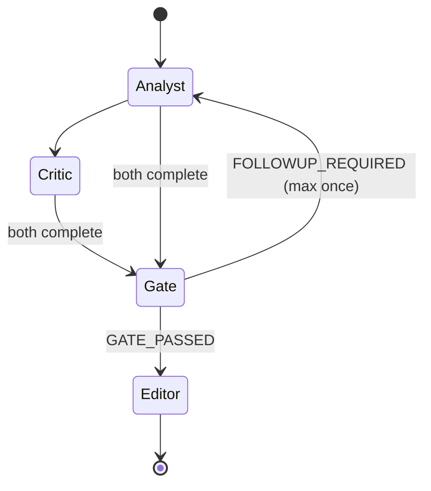

# Architecture

## The shape of the problem

Most "research agent" designs are a loop: *search → read → summarise*. That works for a one-off question and fails as a standing watch, for three reasons:

1. **It has no memory of what it already told you**, so it re-alerts on the same finding forever.
2. **It cannot tell you it found nothing**, because a summariser always summarises.
3. **It cannot be audited**, because the reasoning is prose and the citations are unverified.

SmartSynergy is designed backwards from those three failures.

---

## Run lifecycle

```
cron ──▶ run-due ──▶ per watch:
          │
          ├─ acquire run lock          (partial unique index; overlapping runs are impossible)
          ├─ check daily cap           (a runaway agent is a billing incident)
          ├─ compute window            (watermark − 7 days overlap, for late indexing)
          │
          └─ per hypothesis:
               ├─ resolve compounds    (PubChem: sotorasib → AMG 510, Lumakras, CID 137278711)
               ├─ invoke Strands Graph (Analyst → Critic → Gate → Editor)
               ├─ final citation gate
               ├─ fingerprint diff vs last dossier
               ├─ atomic commit        (claims + dossier + review item + run, one transaction)
               └─ alert ONLY on material change
          │
          ├─ advance watermark         ONLY if coverage == "complete"
          └─ record run                success or failure, always
```

### Why the 7-day overlap window

Europe PMC indexes papers days to weeks after publication, and corrections are attached to records that already exist. A watch keyed on publication date alone silently misses both. Queries therefore use **`FIRST_IDATE` OR `UPDATE_DATE`**, and every incremental run re-scans the previous seven days. Duplicate work is cheap; a missed retraction is not.

### Why the watermark is conditional

If a run fails halfway, or the search budget truncates it, advancing the watermark would skip that window permanently — and the next run would report "no changes." That is the worst possible failure for a monitoring tool: **silence that looks like reassurance.** So the watermark advances only on a fully complete pass, and partial coverage is displayed on the dossier.

---

## The graph



### Node responsibilities

**Analyst** — searches, reads, proposes claims. Every claim must carry a `supporting_passage` copied verbatim from the source. Returns `AnalystOutput` via `structured_output_model`.

**Critic** — a *separate agent with a separate system prompt* whose only job is to attack. It has its own tools, so it can go and find the contradicting paper rather than merely doubting in the abstract. It looks for: wrong tumour type, wrong variant, missing comparator, preclinical result stated as clinical, retraction or correction. Returns `CriticOutput`.

Two agents matter here. Asking one model to "also consider counterarguments" produces counterarguments shaped to be dismissed. A critic that never saw the analyst's reasoning as its own produces real ones.

**Evidence gate** — a custom `MultiAgentBase` node. Not a model. This is the trust boundary, and it is ordinary Python with unit tests:

- drops any claim whose `source_id` was never returned by a tool this run
- verifies each quote against the stored source text, whitespace- and case-normalised
- applies critic challenges as **mechanical demotions**, not suggestions
- decides whether one follow-up pass is warranted — and permits it only once
- emits `GATE_PASSED` or `FOLLOWUP_REQUIRED`, which the conditional edges route on

**Editor** — writes the brief in `[claim:ID]` citation form. A final gate then rejects the brief outright if it references a claim ID that is not in the ledger. Evidence tables in the UI and in exports are rendered **from the ledger**, never from the editor's prose, so a hallucinated citation has no path to a rendered document.

### AND-join semantics

Strands' Python `Graph` fires a node when **any** incoming edge completes. The gate needs both upstream agents, so both edges into it carry an explicit condition:

```python
def _both_done(*node_ids):
    def condition(state: GraphState) -> bool:
        return all(state.results.get(n) and state.results[n].status == Status.COMPLETED
                   for n in node_ids)
    return condition
```

### Bounded self-correction

The feedback edge `Gate → Analyst` is what makes this more than a pipeline: the system can discover its evidence is inadequate and go back for more. Unbounded, it is also how an agent burns a budget overnight. Three independent limits apply: the gate's own one-follow-up rule, `set_max_node_executions(9)`, and per-node plus whole-run timeouts.

---

## Change detection

Every dossier carries a **fingerprint**: a hash over its accepted claims, each reduced to `(source_id, label, context_match, study_design)` and sorted. It is deliberately blind to wording, ordering and timestamps.

```
same evidence, different prose      → same fingerprint → silence
same evidence, different ordering   → same fingerprint → silence
new applicable paper                → new fingerprint  → inbox
```

A changed fingerprint is necessary but not sufficient. The controller then asks *why* it changed and only raises an item for one of four material reasons (retraction, direct counterevidence, applicability failure, new direct support), ranked by urgency. Everything else is recorded silently.

Idempotency is enforced at the storage layer, not in application logic: `UNIQUE(watch_id, hypothesis_id, fingerprint_after)` on `review_items`. Re-running the same analysis a hundred times produces exactly one alert.

---

## Data model

| Table | Holds | Guarantee |
| --- | --- | --- |
| `watches` | What to monitor, schedule, watermark | one row per watch |
| `sources` | Every retrieved record + content hash | `UNIQUE(watch_id, source_id)` — "new" is a fact, not a guess |
| `claims` | Evidence claims with verbatim passages | deterministic `claim_id`; stable across runs |
| `dossiers` | Versioned assessments | full history retained, never overwritten |
| `review_items` | The inbox | `UNIQUE(watch_id, hypothesis_id, fingerprint_after)` |
| `runs` | Audit trail incl. failures | partial unique index prevents concurrent runs |

Claims, dossier, review item and run status are written in **one `BEGIN IMMEDIATE` transaction**. A crash mid-write cannot leave an alert pointing at claims that were never stored.

---

## Deployment

The worker is a single command with no daemon state, so it runs anywhere a cron entry runs:

```cron
0 6 * * *  cd /srv/SmartSynergy && .venv/bin/python -m smartsynergy.worker run-due
```

The same entry point maps directly onto **Amazon Bedrock AgentCore** with an EventBridge schedule, since `run_watch()` returns a JSON-serialisable `RunSummary`. SQLite is the local store; the storage layer is a single class behind which DynamoDB would drop in for multi-user deployment.

---

## What was deliberately left out

- **A synergy score.** Explained in the README: it would demo well and mean nothing.
- **Automatic actions.** The agent never emails a collaborator or files anything. In a research setting the value is in *deciding what deserves attention*; the action stays with the human.
- **Chat.** Every question a user might ask — why this claim, what changed, what would change your mind — is answered by the interface without a conversation.
